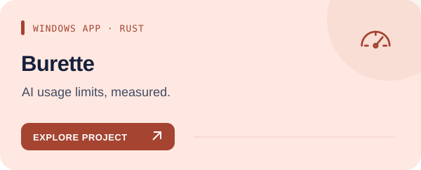
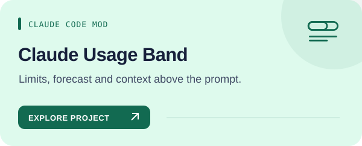
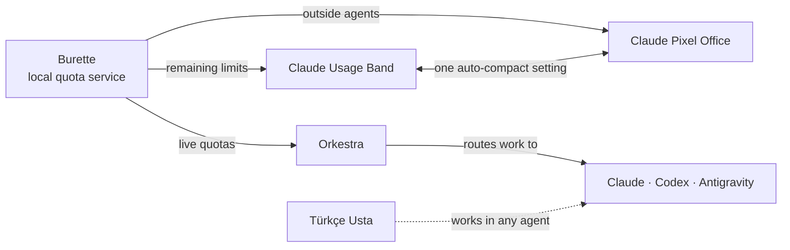

<picture>
  <source media="(prefers-color-scheme: dark)" srcset="assets/studio/hero-en-dark.svg">
  
</picture>

[English](README.md) · [Türkçe](README.tr.md)

### Turning ideas into things you can use.

I build open tools for working with several AI models at once: see how much of your limits is left, send each task to the right model, watch your agents work, and get proper Turkish out of them. Everything here is free and open source.

<p>
<a href="#projects"></a>
<a href="#quick-install"></a>
<a href="https://iamyigit.com"></a>
</p>

## Projects

Each card opens the project and its guide.

| | |
|---|---|
| [](https://github.com/yigityildiz0/burette)<br>**[Burette](https://github.com/yigityildiz0/burette)** | [](https://github.com/yigityildiz0/orkestra)<br>**[Orkestra](https://github.com/yigityildiz0/orkestra)** |
| [](https://github.com/yigityildiz0/claude-usage-band)<br>**[Claude Usage Band](https://github.com/yigityildiz0/claude-usage-band)** | [](https://github.com/yigityildiz0/claude-pixel-office)<br>**[Claude Pixel Office](https://github.com/yigityildiz0/claude-pixel-office)** |
| [](https://github.com/yigityildiz0/turkce-usta)<br>**[Türkçe Usta](https://github.com/yigityildiz0/turkce-usta)** | [](https://github.com/yigityildiz0/betterdiscord-auto-repair-launcher)<br>**[BetterDiscord Launcher](https://github.com/yigityildiz0/betterdiscord-auto-repair-launcher)** |

Also here: [iamyigit-site](https://github.com/yigityildiz0/iamyigit-site), a bilingual Next.js personal-site starter (Turkish and English, light and dark themes, tests).

## How they fit together

Every project works on its own. Install Burette as well and the others get live data from it: the usage band and Orkestra read the remaining limits, and Pixel Office seats agents running in other terminals.



## Quick install

| Project | Works with | Install |
|---|---|---|
| **Burette** | Windows 10/11 | Download the setup file from [Releases](https://github.com/yigityildiz0/burette/releases/latest) |
| **Orkestra** | Claude Code (+ Codex, Antigravity) | Clone into `~/.claude/skills/orkestra`, then run `ork.py kur` ([steps](https://github.com/yigityildiz0/orkestra#install)) |
| **Claude Usage Band** | Claude Code | `/plugin install kota-bandi --marketplace yigityildiz0/claude-usage-band` |
| **Claude Pixel Office** | Claude Code | `/plugin install piksel-ofis --marketplace yigityildiz0/claude-pixel-office` |
| **Türkçe Usta** | Claude Code, Codex, Gemini CLI | Download [turkce-usta.zip](https://github.com/yigityildiz0/turkce-usta/releases/latest/download/turkce-usta.zip) |
| **BetterDiscord Launcher** | Windows 10/11 | Download from [Releases](https://github.com/yigityildiz0/betterdiscord-auto-repair-launcher/releases/latest) |

<details>
<summary><strong>Prefer to let your AI install it?</strong></summary>

Paste this into Claude Code, Codex or Antigravity and replace the project name:

```text
Install https://github.com/yigityildiz0/<project> on my computer. Read its README and AGENTS.md first, follow the steps for my system, then run the checks it lists and tell me the result.
```

</details>

---

Free and open source; each repository states its license. Not affiliated with Anthropic, OpenAI or Google.

[Website](https://iamyigit.com) · [All repositories](https://github.com/yigityildiz0?tab=repositories) · [Profile source](https://github.com/yigityildiz0/yigityildiz0)
