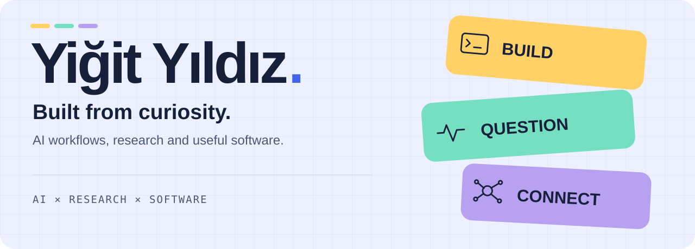
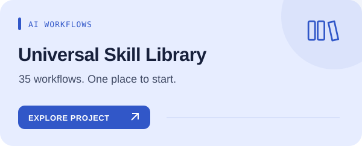
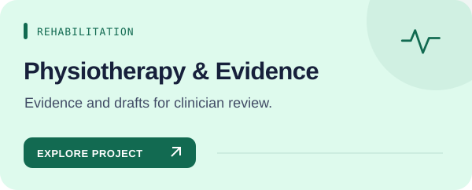
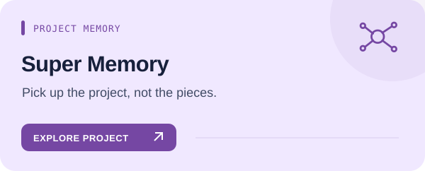
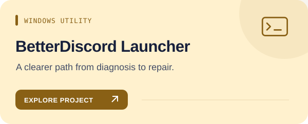
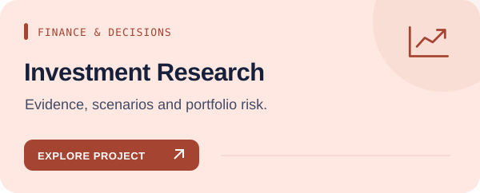
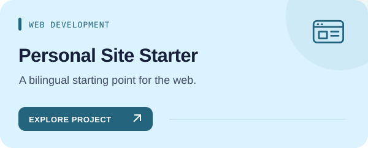

<picture>
  <source media="(prefers-color-scheme: dark)" srcset="assets/studio/hero-en-dark.svg">
  
</picture>

[English](README.md) · [Türkçe](README.tr.md)

### Turning ideas into things you can use.

I explore questions, connect ideas and turn what I learn into useful tools. This is where my AI workflows, source-led research and practical software live.

**Looking for a workflow?** Search by the job you want to do, see how it works, and pick only the skill you need.

**New:** [presentation-studio](https://github.com/yigityildiz0/universal-ai-skill-library/blob/main/docs/skills/presentation-studio.en.md) builds complete, editable PowerPoint decks with speaker notes, real images and a rendered quality check — in Claude, ChatGPT/Codex, Gemini and other agents.

## Projects

Different colors, different kinds of work. Each card opens the project and its guide.

| | |
|---|---|
|  **[Universal Skill Library](https://github.com/yigityildiz0/universal-ai-skill-library)** |  **[Physiotherapy & Evidence](https://github.com/yigityildiz0/physiotherapy-clinical-skills)** |
|  **[Super Memory](https://github.com/yigityildiz0/super-memory)** |  **[BetterDiscord Launcher](https://github.com/yigityildiz0/betterdiscord-auto-repair-launcher)** |
|  **[Investment Research](https://github.com/yigityildiz0/yigit-investment-copilot)** |  **[Personal Site Starter](https://github.com/yigityildiz0/iamyigit-site)** |

<strong>🧭 Help me choose a starting point</strong>

| Your next task | Start here |
|---|---|
| Code, writing, analysis or research | [Skill catalog](https://yigityildiz0.github.io/universal-ai-skill-library/) |
| Rehabilitation evidence and learning | [Physiotherapy collection](https://github.com/yigityildiz0/physiotherapy-clinical-skills) |
| Hand a project to another agent | [Super Memory](https://github.com/yigityildiz0/super-memory) |

<strong>All projects and collections</strong>

| Repository | Scope |
|---|---|
| [Universal AI Skill Library](https://github.com/yigityildiz0/universal-ai-skill-library) | Source-led workflows for development, design, research, clinical reasoning and everyday work. |
| [AI Development Skills](https://github.com/yigityildiz0/ai-development-skills) | Software delivery, AI tooling, current documentation and codebase understanding. |
| [Design & Content Skills](https://github.com/yigityildiz0/design-content-skills) | Interface design, visual systems, writing, presentations and image/video workflows. |
| [Evidence & Research Skills](https://github.com/yigityildiz0/evidence-research-skills) | Source-led research, evidence appraisal, data analysis and research synthesis. |
| [Physiotherapy & Clinical Skills](https://github.com/yigityildiz0/physiotherapy-clinical-skills) | Clinical reasoning, rehabilitation evidence, study support and crisis response workflows. |
| [Investment Research Copilot](https://github.com/yigityildiz0/yigit-investment-copilot) | Investment research workflows for market evidence, scenarios, portfolio risk and decision plans. |
| [Finance Skills — Maintained Collection](https://github.com/yigityildiz0/universal-ai-finance-skills) | The maintained finance collection: investment research, data analysis and purchase due diligence. |
| [Scientific Skills — Maintained Collection](https://github.com/yigityildiz0/scientific-agent-skills) | Maintained scientific workflows for literature, study, analysis, AI research and document quality. |
| [Smart Route Planning](https://github.com/yigityildiz0/map-skill) | Source-aware route planning with public transport, walking, scheduling and explicit live-data limits. |
| [Truth-First — Maintained Research Workflows](https://github.com/yigityildiz0/truth-first-counterargument-skill) | Claim verification, evidence integrity and decision challenges within the maintained research hub. |
| [Super Memory](https://github.com/yigityildiz0/super-memory) | Project-local memory and evidence-based handoffs for long AI sessions. |
| [BetterDiscord Auto Repair Launcher](https://github.com/yigityildiz0/betterdiscord-auto-repair-launcher) | Windows utility; not an AI skill. |
| [iamyigit-site](https://github.com/yigityildiz0/iamyigit-site) | Bilingual Next.js application starter. |

<strong>🛠️ How I work and how the library stays current</strong>

**Source first, clear boundaries, reusable parts.** The library contains 35 entry points: 34 current personal-master roots plus Super Memory. Each has separate English/Turkish guides; domain collections are selected views of the same source. Historical community material is separate from the maintained/tested scope.

I use existing host tools, open sources and local computation—not an automatic extra paid-service fallback. Packaging, testing and actual account activation are separate stages.

[Architecture & maintenance](https://github.com/yigityildiz0/universal-ai-skill-library/blob/main/MAINTAINING.md) · [Downloads](https://github.com/yigityildiz0/universal-ai-skill-library/blob/main/DOWNLOADS.md)

---

Clinical and investment outputs do not replace professional judgment. A skill file does not provide account access, API credit or a model.

[Website](https://iamyigit.com) · [All repositories](https://github.com/yigityildiz0?tab=repositories) · [Profile source](https://github.com/yigityildiz0/yigityildiz0)
