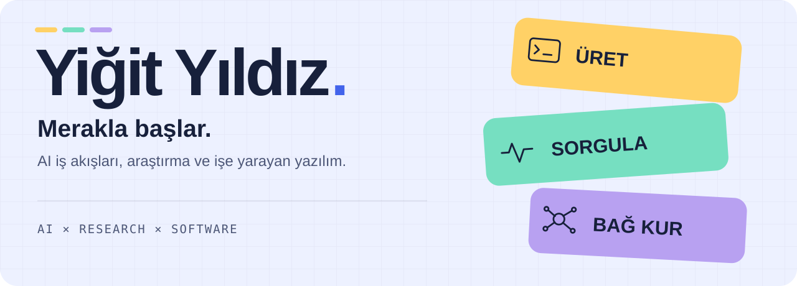
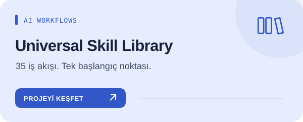
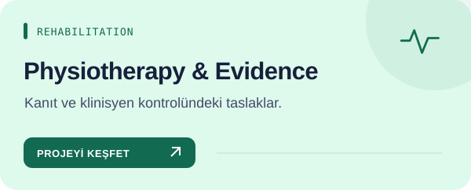
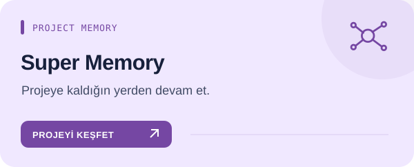
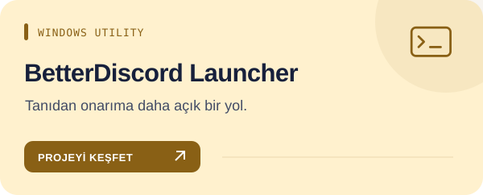
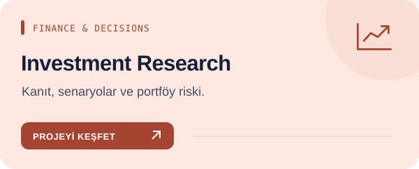
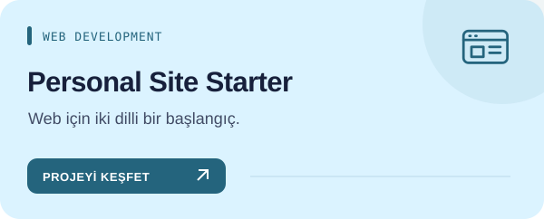

<picture>
  <source media="(prefers-color-scheme: dark)" srcset="assets/studio/hero-tr-dark.svg">
  
</picture>

[English](README.md) · [Türkçe](README.tr.md)

### Fikirleri işe yarayan şeylere dönüştürmek.

Merak ettiğim şeyleri araştırıyor, öğrendiklerimi işe yarayan araçlara dönüştürüyorum. Burada AI iş akışları, kaynak temelli araştırma ve pratik yazılım var.

**Bir iş akışı mı arıyorsun?** Katalogda görevine göre ara; nasıl çalıştığını oku ve yalnız ihtiyacın olan skill’i seç.

**Yeni:** [pdf-studio](https://github.com/yigityildiz0/universal-ai-skill-library/blob/main/docs/skills/pdf-studio.tr.md) güvenilir PDF hazırlar (bölünen tablo, yalnız kalan başlık yok) ve [presentation-studio](https://github.com/yigityildiz0/universal-ai-skill-library/blob/main/docs/skills/presentation-studio.tr.md) düzenlenebilir PowerPoint sunumunu konuşmacı notları, gerçek görseller ve render kontrolüyle baştan sona hazırlar — Claude, ChatGPT/Codex, Gemini ve diğer ajanlarda.

## Projeler

Her renk, farklı bir çalışma alanı. Kartlar doğrudan proje rehberine gider.

| | |
|---|---|
|  **[Universal Skill Library](https://github.com/yigityildiz0/universal-ai-skill-library/blob/main/README.tr.md)** |  **[Physiotherapy & Evidence](https://github.com/yigityildiz0/physiotherapy-clinical-skills/blob/main/README.tr.md)** |
|  **[Super Memory](https://github.com/yigityildiz0/super-memory/blob/main/README.tr.md)** |  **[BetterDiscord Launcher](https://github.com/yigityildiz0/betterdiscord-auto-repair-launcher/blob/main/README.tr.md)** |
|  **[Investment Research](https://github.com/yigityildiz0/yigit-investment-copilot/blob/main/README.tr.md)** |  **[Personal Site Starter](https://github.com/yigityildiz0/iamyigit-site/blob/main/README.tr.md)** |

<strong>🧭 Bana bir başlangıç noktası öner</strong>

| İstediğin iş | Buradan başla |
|---|---|
| Kod, yazı, analiz veya araştırma | [Skill kataloğu](https://yigityildiz0.github.io/universal-ai-skill-library/) |
| Rehabilitasyon kanıtı ve öğrenme | [Fizyoterapi koleksiyonu](https://github.com/yigityildiz0/physiotherapy-clinical-skills) |
| Ajanlar arasında proje devri | [Super Memory](https://github.com/yigityildiz0/super-memory) |

<strong>Tüm proje ve koleksiyonlar</strong>

| Repository | Kapsam |
|---|---|
| [Universal AI Skill Library](https://github.com/yigityildiz0/universal-ai-skill-library) | Geliştirme, tasarım, araştırma, klinik akıl yürütme ve günlük işler için kaynak temelli iş akışları. |
| [AI Development Skills](https://github.com/yigityildiz0/ai-development-skills) | Yazılım geliştirme, AI araçları, güncel dokümantasyon ve kod tabanını anlama iş akışları. |
| [Design & Content Skills](https://github.com/yigityildiz0/design-content-skills) | Arayüz, görsel sistem, yazı, sunum ve görsel/video üretim iş akışları. |
| [Evidence & Research Skills](https://github.com/yigityildiz0/evidence-research-skills) | Kaynak temelli araştırma, kanıt değerlendirme, veri analizi ve araştırma sentezi. |
| [Physiotherapy & Clinical Skills](https://github.com/yigityildiz0/physiotherapy-clinical-skills) | Klinik akıl yürütme, rehabilitasyon kanıtları, öğrenme ve kriz desteği iş akışları. |
| [Investment Research Copilot](https://github.com/yigityildiz0/yigit-investment-copilot) | Piyasa kanıtları, senaryolar, portföy riski ve karar planları için yatırım araştırması iş akışları. |
| [Finance Skills — Maintained Collection](https://github.com/yigityildiz0/universal-ai-finance-skills) | Bakımı sürdürülen finans koleksiyonu: yatırım araştırması, veri analizi ve satın alma değerlendirmesi. |
| [Scientific Skills — Maintained Collection](https://github.com/yigityildiz0/scientific-agent-skills) | Literatür, öğrenme, analiz, AI araştırması ve belge kalitesi için güncel bilimsel iş akışları. |
| [Smart Route Planning](https://github.com/yigityildiz0/map-skill) | Toplu taşıma, yürüyüş, zamanlama ve açık canlı veri sınırlarıyla kaynak temelli rota planlama. |
| [Truth-First — Maintained Research Workflows](https://github.com/yigityildiz0/truth-first-counterargument-skill) | Güncel araştırma merkezi içinde iddia doğrulama, kanıt bütünlüğü ve karar sorgulama. |
| [Super Memory](https://github.com/yigityildiz0/super-memory) | Uzun AI oturumları için proje-yerel hafıza ve kanıtlı devir notları. |
| [BetterDiscord Auto Repair Launcher](https://github.com/yigityildiz0/betterdiscord-auto-repair-launcher) | Windows yardımcı uygulaması; skill değildir. |
| [iamyigit-site](https://github.com/yigityildiz0/iamyigit-site) | İki dilli Next.js başlangıç projesi. |

<strong>🛠️ Nasıl çalışıyorum ve kütüphane nasıl güncelleniyor?</strong>

**Kaynak önce, açık sınırlar, yeniden kullanılabilir parçalar.** Kütüphane; 34 güncel kişisel master kökü ve Super Memory ile 35 giriş noktası içerir. Her skill için ayrı İngilizce/Türkçe rehber var; alan koleksiyonları aynı kaynağın seçilmiş görünümleridir. Eski topluluk kaynakları güncel/testli kapsamdan ayrı tutulur.

Mevcut host araçlarını, açık kaynakları ve yerel işlemi kullanırım; ek ücretli servis otomatik alternatif değildir. Paket üretimi, test ve gerçek hesapta aktivasyon farklı aşamalardır.

[Architecture & maintenance](https://github.com/yigityildiz0/universal-ai-skill-library/blob/main/MAINTAINING.md) · [Downloads](https://github.com/yigityildiz0/universal-ai-skill-library/blob/main/DOWNLOADS.md)

---

Klinik ve yatırım çıktıları profesyonel değerlendirmenin yerine geçmez. Skill dosyası hesap yetkisi, API kredisi veya model sağlamaz.

[Website](https://iamyigit.com) · [All repositories](https://github.com/yigityildiz0?tab=repositories) · [Profile source](https://github.com/yigityildiz0/yigityildiz0)
