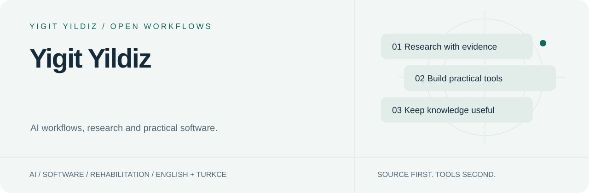
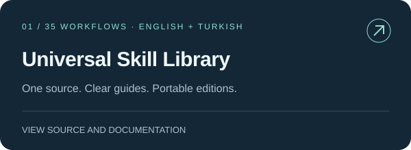
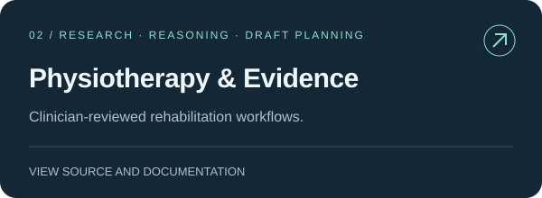
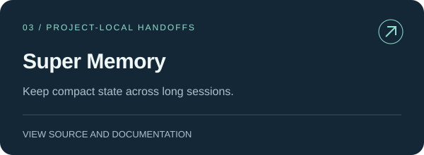
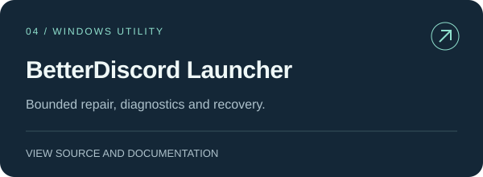
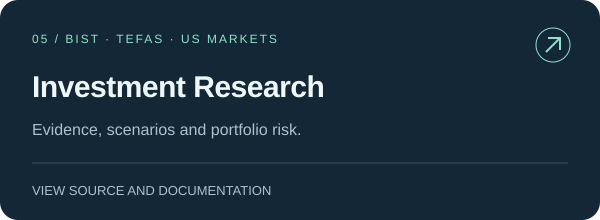
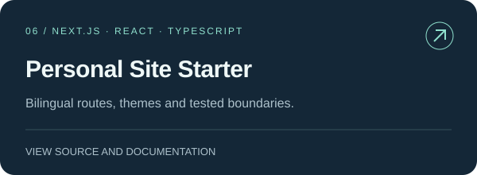

<picture>
  <source media="(prefers-color-scheme: dark)" srcset="assets/hero-dark.svg">
  
</picture>

# Merhaba, ben Yiğit.

[English](README.md) · [Türkçe](README.tr.md)

AI iş akışları, kaynak temelli araştırma ve pratik yazılım geliştiriyorum. Ortak fikir: **bir soruyu, anlaşılır ve incelenebilir bir çalışma sürecine dönüştürmek.**

[Skill catalog ↗](https://yigityildiz0.github.io/universal-ai-skill-library/) · [Website ↗](https://iamyigit.com) · [Source library ↗](https://github.com/yigityildiz0/universal-ai-skill-library)

## Nereden başlamak istersin?

| Amaç | Başlangıç noktası |
|---|---|
| Bir AI iş akışı seçmek | [35 skill içeren aramalı katalog](https://yigityildiz0.github.io/universal-ai-skill-library/) — görev, mekanik, örnek ve kaynak. |
| Rehabilitasyon kanıtını değerlendirmek | [Fizyoterapi ve klinik koleksiyon](https://github.com/yigityildiz0/physiotherapy-clinical-skills) — kanıt, akıl yürütme ve klinisyen kontrolündeki taslaklar. |
| Pratik bir araç veya uygulamayı incelemek | [Windows başlatıcı](https://github.com/yigityildiz0/betterdiscord-auto-repair-launcher) ve [iki dilli site başlangıcı](https://github.com/yigityildiz0/iamyigit-site). |

## Seçilmiş projeler

| | |
|---|---|
|  |  |
|  |  |
|  |  |

## Kütüphanenin bakım modeli

**Tek kaynak; kalıcı alan koleksiyonları.** Genel kütüphanede güncel kişisel masterın 34 kökü ile mevcut Super Memory skill’i birleşir. Alan depoları aynı kaynağın seçilmiş görünümleridir; yeni güncellemede yeniden repo birleştirip bölmek gerekmez.

Her skill için ayrı İngilizce ve Türkçe rehber vardır. Önceki topluluk kataloğu korunur ama güncel/testli kapsamla karıştırılmaz. Paket üretimi, yerel doğrulama ve bulut hesabında gerçekten çalıştırma ayrı aşamalardır.

[Architecture & maintenance](https://github.com/yigityildiz0/universal-ai-skill-library/blob/main/MAINTAINING.md) · [Downloads](https://github.com/yigityildiz0/universal-ai-skill-library/blob/main/DOWNLOADS.md)

<strong>Tüm proje ve koleksiyonlar</strong>

| Repository | Kapsam |
|---|---|
| [Universal AI Skill Library](https://github.com/yigityildiz0/universal-ai-skill-library) | Geliştirme, tasarım, araştırma, klinik akıl yürütme ve günlük işler için kaynak temelli iş akışları. |
| [AI Development Skills](https://github.com/yigityildiz0/ai-development-skills) | Yazılım geliştirme, AI araçları, güncel dokümantasyon ve kod tabanını anlama iş akışları. |
| [Design & Content Skills](https://github.com/yigityildiz0/design-content-skills) | Arayüz, görsel sistem, yazı, sunum ve görsel/video üretim iş akışları. |
| [Evidence & Research Skills](https://github.com/yigityildiz0/evidence-research-skills) | Kaynak temelli araştırma, kanıt değerlendirme, veri analizi ve araştırma sentezi. |
| [Physiotherapy & Clinical Skills](https://github.com/yigityildiz0/physiotherapy-clinical-skills) | Klinik akıl yürütme, rehabilitasyon kanıtları, öğrenme ve kriz desteği iş akışları. |
| [Investment Research Copilot](https://github.com/yigityildiz0/yigit-investment-copilot) | Piyasa kanıtları, senaryolar, portföy riski ve karar planları için yatırım araştırması iş akışları. |
| [Finance Skills — Maintained Collection](https://github.com/yigityildiz0/universal-ai-finance-skills) | Bakımı sürdürülen finans koleksiyonu: yatırım araştırması, veri analizi ve satın alma değerlendirmesi. |
| [Scientific Skills — Maintained Collection](https://github.com/yigityildiz0/scientific-agent-skills) | Literatür, öğrenme, analiz, AI araştırması ve belge kalitesi için güncel bilimsel iş akışları. |
| [Smart Route Planning](https://github.com/yigityildiz0/map-skill) | Toplu taşıma, yürüyüş, zamanlama ve açık canlı veri sınırlarıyla kaynak temelli rota planlama. |
| [Truth-First — Maintained Research Workflows](https://github.com/yigityildiz0/truth-first-counterargument-skill) | Güncel araştırma merkezi içinde iddia doğrulama, kanıt bütünlüğü ve karar sorgulama. |
| [Super Memory](https://github.com/yigityildiz0/super-memory) | Uzun AI oturumları için proje-yerel hafıza ve kanıtlı devir notları. |
| [BetterDiscord Auto Repair Launcher](https://github.com/yigityildiz0/betterdiscord-auto-repair-launcher) | Windows yardımcı uygulaması; skill değildir. |
| [iamyigit-site](https://github.com/yigityildiz0/iamyigit-site) | İki dilli Next.js başlangıç projesi. |

## Çalışma ilkeleri

- **Kaynak önce:** iddiayı onu taşıyan belge, veri veya kodla ilişkilendir.
- **Açık sınırlar:** yapılan kontrolü önerilen kontrolden ayır; bilinmeyeni saklama.
- **Kalıcı düzen:** küçük, yeniden kullanılabilir parçalar; tek bakım kaynağı.
- **Gerçek ortam:** mevcut host araçlarını kullan; ek ücretli servisi otomatik alternatif yapma.

Klinik ve yatırım çıktıları insan/profesyonel değerlendirmesinin yerine geçmez. Skill dosyası bir hesaba yetki, API kredisi veya model kazandırmaz.

---
[Profile source](https://github.com/yigityildiz0/yigityildiz0) · [Project issues and contributions](https://github.com/yigityildiz0/universal-ai-skill-library/issues)
