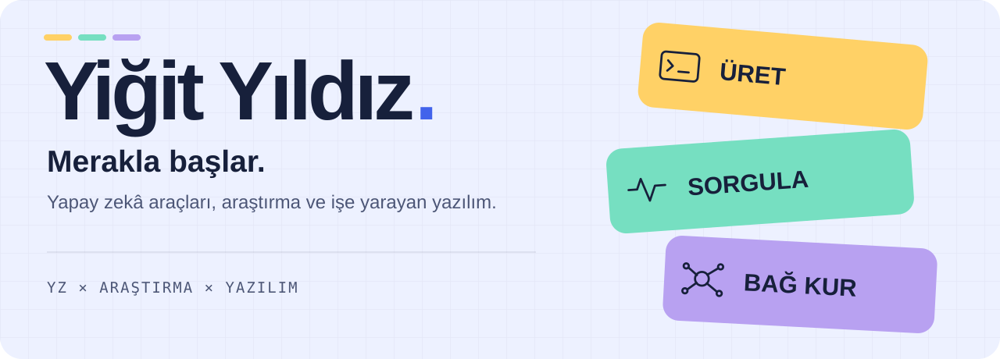
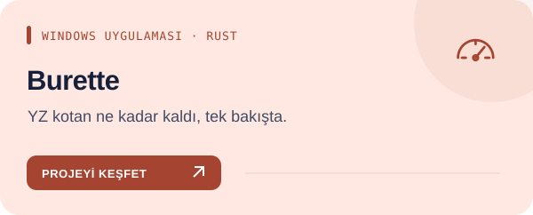
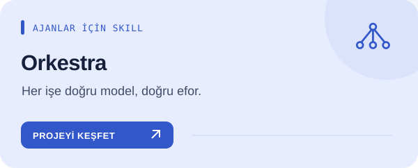
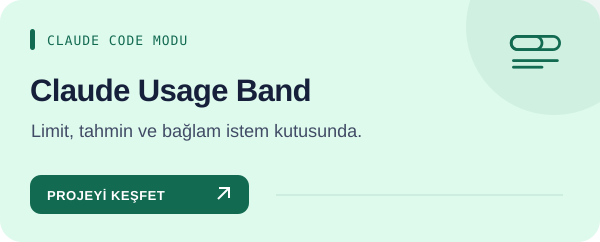
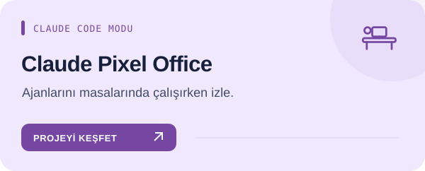
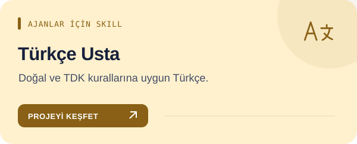
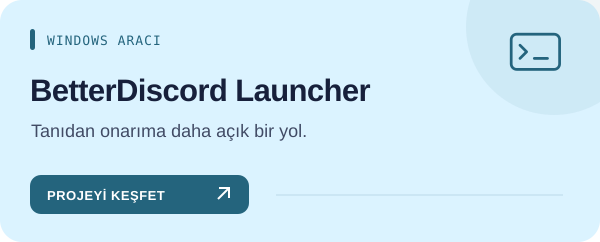
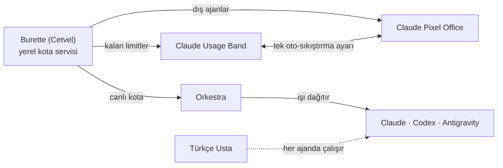

<picture>
  <source media="(prefers-color-scheme: dark)" srcset="assets/studio/hero-tr-dark.svg">
  
</picture>

[English](README.md) · [Türkçe](README.tr.md)

### Fikirleri işe yarayan şeylere dönüştürmek.

Birden çok yapay zekâ modeliyle aynı anda çalışmak için açık araçlar yapıyorum: limitlerinden ne kaldığını gör, her işi doğru modele gönder, ajanlarını çalışırken izle, Türkçeyi düzgün yazdır. Buradaki her şey ücretsiz ve açık kaynak.

<p>
<a href="#projeler"></a>
<a href="#kurulum"></a>
<a href="https://iamyigit.com"></a>
</p>

## Projeler

Her kart projeyi ve rehberini açar.

| | |
|---|---|
| [](https://github.com/yigityildiz0/burette/blob/main/README.tr.md)<br>**[Burette](https://github.com/yigityildiz0/burette/blob/main/README.tr.md)** | [](https://github.com/yigityildiz0/orkestra/blob/main/README.tr.md)<br>**[Orkestra](https://github.com/yigityildiz0/orkestra/blob/main/README.tr.md)** |
| [](https://github.com/yigityildiz0/claude-usage-band/blob/main/README.tr.md)<br>**[Claude Usage Band](https://github.com/yigityildiz0/claude-usage-band/blob/main/README.tr.md)** | [](https://github.com/yigityildiz0/claude-pixel-office/blob/main/README.tr.md)<br>**[Claude Pixel Office](https://github.com/yigityildiz0/claude-pixel-office/blob/main/README.tr.md)** |
| [](https://github.com/yigityildiz0/turkce-usta)<br>**[Türkçe Usta](https://github.com/yigityildiz0/turkce-usta)** | [](https://github.com/yigityildiz0/betterdiscord-auto-repair-launcher/blob/main/README.tr.md)<br>**[BetterDiscord Launcher](https://github.com/yigityildiz0/betterdiscord-auto-repair-launcher/blob/main/README.tr.md)** |

Ayrıca: [iamyigit-site](https://github.com/yigityildiz0/iamyigit-site/blob/main/README.tr.md), iki dilli (Türkçe ve İngilizce) Next.js kişisel site başlangıç projesi; açık/koyu tema ve testlerle.

## Birlikte nasıl çalışır

Her proje tek başına çalışır. Burette’i de kurarsan diğerleri ondan canlı veri alır: kota bandı ve Orkestra kalan limitleri okur, Pixel Office başka terminallerde çalışan ajanları da masaya oturtur.



## Kurulum

| Proje | Nerede çalışır | Kurulum |
|---|---|---|
| **Burette (Cetvel)** | Windows 10/11 | Kurulum dosyasını [Releases](https://github.com/yigityildiz0/burette/releases/latest) sayfasından indir |
| **Orkestra** | Claude Code (+ Codex, Antigravity) | `~/.claude/skills/orkestra` klasörüne klonla, sonra `ork.py kur` çalıştır ([adımlar](https://github.com/yigityildiz0/orkestra/blob/main/README.tr.md#kurulum)) |
| **Claude Usage Band** | Claude Code | `/plugin install kota-bandi --marketplace yigityildiz0/claude-usage-band` |
| **Claude Pixel Office** | Claude Code | `/plugin install piksel-ofis --marketplace yigityildiz0/claude-pixel-office` |
| **Türkçe Usta** | Claude Code, Codex, Gemini CLI | [turkce-usta.zip](https://github.com/yigityildiz0/turkce-usta/releases/latest/download/turkce-usta.zip) dosyasını indir |
| **BetterDiscord Launcher** | Windows 10/11 | [Releases](https://github.com/yigityildiz0/betterdiscord-auto-repair-launcher/releases/latest) sayfasından indir |

<details>
<summary><strong>Kurulumu yapay zekâna mı bırakmak istersin?</strong></summary>

Bunu Claude Code, Codex ya da Antigravity’ye yapıştır, proje adını değiştir:

```text
https://github.com/yigityildiz0/<proje> projesini bilgisayarıma kur. Önce README ve AGENTS.md dosyalarını oku, sistemime uygun adımları izle, sonra belgede yazan kontrolleri çalıştırıp sonucu bana söyle.
```

</details>

---

Ücretsiz ve açık kaynak; her repo kendi lisansını belirtir. Anthropic, OpenAI ya da Google ile bağlantısı yoktur.

[Web sitem](https://iamyigit.com) · [Tüm repolar](https://github.com/yigityildiz0?tab=repositories) · [Profil kaynağı](https://github.com/yigityildiz0/yigityildiz0)
